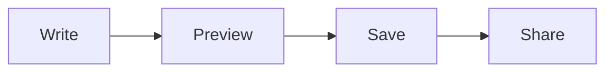

The editor shows Markdown source in the same column as the rendered page, with a preview, toolbar and shortcuts.

Type the title where the page title sits. Tags go under it. **Page details** holds the page path, the hidden setting and **delete page**. Start body sections at `##`. Press **preview** or `ctrl-e` (`cmd-e` on macOS) to switch between source and preview. The status line shows the word count.

## Markdown basics

| To write | Use |
| --- | --- |
| A section heading | `## Plan` |
| A smaller heading | `### Details` |
| Bold or italic text | `**important**` or `*emphasis*` |
| A bullet list | `- First item` on each line |
| A numbered list | `1. First step` on each line |
| An unchecked or completed task | `- [ ] To do` or `- [x] Done` |
| Inline code | Surround text with backticks |
| An external link | `[Example](https://example.com)` |
| A link to another wiki page | `[[Page Title]]` |
| A quoted note | `> A note for readers` |

Leave a blank line between paragraphs. For a code block, put three backticks on a line before and after it, with a language name after the opening backticks:

````markdown
```sh
printf 'Hello from HMD\n'
```
````

Each code block on a saved page has a **Copy** button, in the live wiki and static exports. If the browser blocks clipboard access, the button selects the code and asks you to press **Ctrl+C** (**Cmd+C** on macOS).

See [[Links And Navigation]] for page links and [[Attachments]] for uploaded images and files.

## Toolbar


| Control | What it does |
| --- | --- |
| **B**, **I** | Bold and italic |
| **H** | Insert a heading |
| **link** | Turn the selected text into a `[text](url)` link |
| **code** | Wrap the selection in code |
| **table** | Insert a table |
| **img** | Insert an image placeholder |
| **attach** | Upload an attachment |
| **toc** | Insert a `<!-- hmd:toc -->` token |
| **focus** | Show only the title and the writing, larger, with all but the current line dimmed |
| **preview** | Show the rendered page in place of the source |

## Keyboard shortcuts

`ctrl` works on Windows and Linux; `cmd` on macOS.

| Shortcut | What it does |
| --- | --- |
| `ctrl-s` / `cmd-s` | Save |
| `ctrl-k` / `cmd-k`, or `/` | Open the command palette |
| `ctrl-e` / `cmd-e` | Edit the current page; in the editor, switch between source and preview |
| `ctrl-j` / `cmd-j` | New page from the namespace's quick-create template |
| `ctrl-shift-k` / `cmd-shift-k` | Insert a link (`[text](url)`) |
| `ctrl-b` / `cmd-b`, `ctrl-i` / `cmd-i` | Bold, italic |
| `alt-1`, `alt-2`, `alt-3` | Heading levels 1 to 3 |
| `ctrl-shift-f` | Focus mode; `esc` leaves it |

In focus mode, move the mouse to show a corner bar with the word count, text size controls and **Exit**. HMD remembers the text size.

## Diagrams

Fenced `mermaid` blocks render as diagrams in the preview and on the saved page:

````markdown

````


## Raw HTML

Raw HTML in page bodies is rendered. A sanitizer strips scripts and event handlers, but the rest is trusted content, so give editing access only to users you trust.

## Common pitfalls

- Drafts are saved locally and restored if the page changes, but only a save writes to the repository.
- The link button and `ctrl-shift-k` insert `[text](url)`. For a wiki-link that shows in backlinks, type `[[Title]]` by hand.
- Navigating away with unsaved changes shows a warning.

## Next steps

[[Pages]], [[Attachments]], [[Links And Navigation]].
